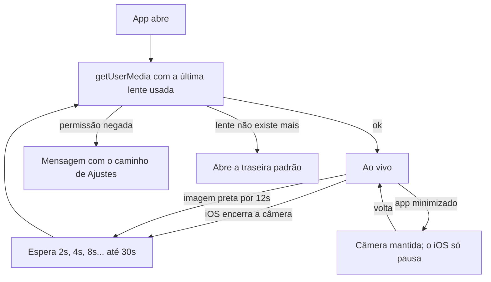

# Arquitetura

O Lentes é um app web estático (PWA), sem build e sem dependências em produção. Ele é publicado pelo GitHub Pages a partir da branch `main`.

## Módulos

| Arquivo                | Responsabilidade                                                                            |
| ---------------------- | ------------------------------------------------------------------------------------------- |
| `index.html`           | Marcação da interface                                                                       |
| `css/app.css`          | Estilos                                                                                     |
| `js/main.js`           | Ponto de entrada: liga os módulos à interface, foto, modo foto/vídeo e diagnóstico          |
| `js/camera.js`         | Abre a lente escolhida, religa após corte do iOS, detecta imagem preta e controla o zoom    |
| `js/recorder.js`       | Gravação de vídeo com `MediaRecorder` (MP4 no iOS) e microfone                              |
| `js/gallery.js`        | Galeria interna: salvamento automático, envio ao Fotos, visualizador e seleção              |
| `js/selection.js`      | Gestos de seleção estilo app Fotos (segurar, arrastar, rolagem na borda)                    |
| `js/media-store.js`    | Persistência das capturas no IndexedDB                                                      |
| `js/share.js`          | Envio ao app Fotos pela folha de compartilhar                                               |
| `js/lenses.js`         | Regras puras: nomes das lentes, ordem, atalhos de zoom, qualidades, espera entre tentativas |
| `js/ui.js`             | Utilitários de interface: status, aviso, mensagem, confirmação                              |
| `js/log.js`            | Registro exibido no Diagnóstico                                                             |
| `js/prefs.js`          | Preferências no `localStorage`                                                              |
| `sw.js`                | Service worker: guarda o app para uso offline                                               |
| `manifest.webmanifest` | Instalação na Tela de Início                                                                |

## Fluxo da câmera

## Decisões

- **Uma lente por vez.** O app Câmera da Apple liga várias lentes ao mesmo tempo. Abrir uma só gasta menos energia e evita que um módulo com defeito derrube os outros.
- **A câmera não é desligada ao minimizar.** No modo Tela de Início, reabrir a câmera gera um novo pedido de permissão. Mantendo a câmera, o iOS só pausa a imagem.
- **Salvamento automático na galeria interna, não no Fotos.** Um app web não pode gravar no Fotos sem a ação do usuário. A galeria no IndexedDB garante que nada se perde, e o envio ao Fotos é feito em lote.
- **Vídeo a 1920×1440 na qualidade Máxima.** Codificar 4032×3024 em tempo real esquenta o aparelho, justamente o problema que o app tenta contornar.
- **Sem build.** Módulos ES nativos funcionam no Safari, e o service worker guarda arquivo por arquivo.

## Testes

- `tests/unit/`: lógica pura e consistência do projeto (por exemplo, todo arquivo do app está no cache offline). Rodam com `node --test`, sem dependências.
- `tests/e2e/`: Playwright com câmera simulada do Chromium, emulando um iPhone 14 Plus. Os testes cobrem abrir a câmera, foto, vídeo, persistência da galeria, seleção por toque e arrasto e a confirmação de apagar.

Os testes de ponta a ponta usam o Chromium, não o Safari, então não substituem um teste num iPhone de verdade.
